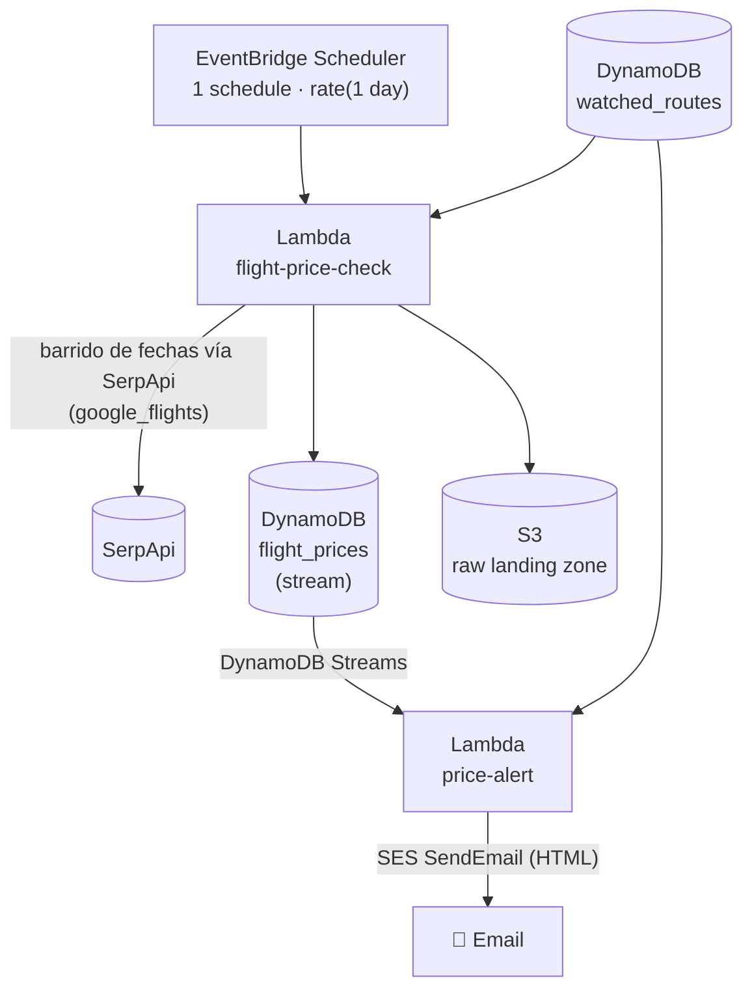

# Flight Price Watcher

Lab personal de DevOps con presupuesto acotado (~$20 USD/mes): infraestructura en AWS armada con [OpenTofu](https://opentofu.org/) para chequear periódicamente precios de vuelos ida y vuelta en rutas elegidas por el usuario (ej. Mendoza→Bariloche), y avisar por mail cuando el mejor precio encontrado baja de un objetivo.

> **Estado actual: activo, validado de punta a punta.** Los precios se obtienen de la API de [SerpApi](https://serpapi.com/) (motor `google_flights`), que trae ambas aerolíneas (Aerolíneas Argentinas y JetSmart) en una sola consulta (ver [Historial](#historial)).

## Arquitectura



Sin VPC, sin ECS, sin NAT Gateway — un solo Lambda hace llamadas HTTPS salientes a `serpapi.com`. Costo estimado: SerpApi Free tier (250 búsquedas/mes) cubre una ruta con barrido diario completo; agregar rutas suma unos pocos dólares/mes como mucho (`$2` cada 1000 búsquedas extra).

## Infra (`infra/`)

Tres raíces de OpenTofu independientes, cada una con su propio estado:

| Directorio | Qué hace |
|---|---|
| `infra/bootstrap/` | Se aplica una sola vez, a mano. Crea el bucket S3 + tabla DynamoDB que usa el backend remoto de `infra/main`. |
| `infra/main/` | La infra real: IAM, las dos tablas DynamoDB, el bucket S3 de raw data, la identidad SES para las alertas, la API key de SerpApi en Secrets Manager, los dos Lambdas, y el scheduler de EventBridge. |
| `infra/github/` | Gestiona el propio repo de GitHub como recurso, separado de la infra de AWS. |

### Cómo desplegar

```bash
cd infra/main
tofu init
tofu plan   -var="alert_email=..." -var="github_repo=..." -var="serpapi_api_key=..."
tofu apply  -var="alert_email=..." -var="github_repo=..." -var="serpapi_api_key=..."
```

El schedule arranca en `DISABLED` a propósito — no corre nada automático hasta validar el pipeline a mano. Más detalle operativo (invocar manualmente, agregar rutas) está en [`CLAUDE.md`](./CLAUDE.md).

## Apps (`apps/`)

- **`flight_price_check/`** — Lambda en Python, solo stdlib + `boto3`. Por cada ruta activa, barre una grilla de fechas de ida (no cada día — un paso configurable) contra el motor `google_flights` de SerpApi, con `type=1` (ida y vuelta) para que el precio ya venga total con impuestos. Prioriza vuelos directos cuando existen, si no usa el más barato en general. Una vez elegido el ganador, hace una llamada extra para traer el detalle completo del tramo de vuelta (horarios, escalas y su duración).
- **`price_alert/`** — Lambda disparado por el stream de DynamoDB de `flight_prices` (agrupa varias rutas de la misma corrida en un solo mail). Compara cada precio nuevo contra el `target_price` de esa ruta en `watched_routes` y manda un mail HTML por SES si está por debajo, con una tabla por ruta (ida y vuelta, vuelos, escalas y su duración), ordenadas por ruta → aerolínea → precio.

`watched_routes` (DynamoDB) se administra directo con `aws dynamodb put-item` — agregar o sacar una ruta, o ajustar el rango de fechas por ruta, no requiere redeploy.

## Historial

La primera versión consultaba directamente los sitios web de cada aerolínea. Esos sitios no ofrecen una API pública y restringen el acceso automatizado, así que en lugar de depender de ellos se pasó a una fuente de datos con API oficial y documentada.

Se investigaron varias alternativas antes de elegir SerpApi: Duffel (cubre AR pero no JetSmart), Amadeus (excluye LCCs explícitamente), Kiwi Tequila (alta por invitación), Travelpayouts (pide 50.000 usuarios activos/mes), Despegar (API B2B de partners, sin pricing público, onboarding comercial), Skyscanner (acceso solo vía aprobación de partner), e Ignav (self-serve y barato, pero se descartó por no revelar su fuente de datos y no tener ninguna huella pública independiente). SerpApi ganó por ser self-serve, con API documentada y pricing transparente, y porque una sola consulta a Google Flights ya trae ambas aerolíneas.
