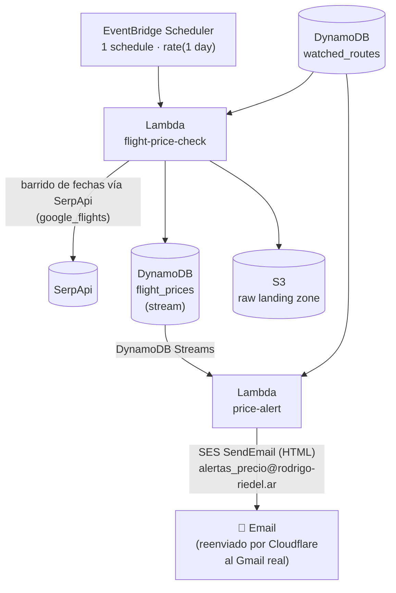
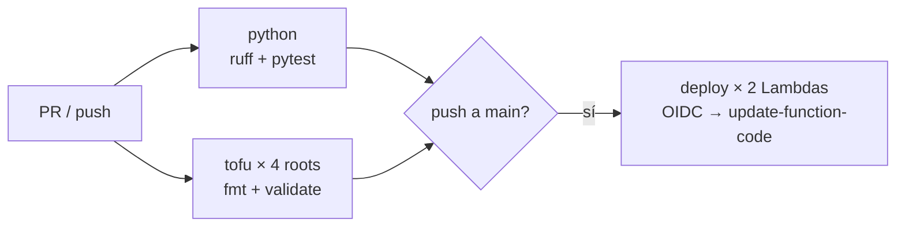

# Flight Price Watcher

[](https://github.com/rmriedel/lab-aws-devops/actions/workflows/ci-cd.yml)

Lab personal de DevOps con presupuesto acotado (~$20 USD/mes): infraestructura en AWS armada con [OpenTofu](https://opentofu.org/) para chequear periódicamente precios de vuelos ida y vuelta en rutas elegidas por el usuario (ej. Mendoza→Bariloche), y avisar por mail cuando el mejor precio encontrado baja de un objetivo.

> **Estado actual: activo, validado de punta a punta.** Los precios se obtienen de la API de [SerpApi](https://serpapi.com/) (motor `google_flights`), que trae ambas aerolíneas (Aerolíneas Argentinas y JetSmart) en una sola consulta (ver [Historial](#historial)).

## Arquitectura



Sin VPC, sin ECS, sin NAT Gateway — un solo Lambda hace llamadas HTTPS salientes a `serpapi.com`. Costo estimado: SerpApi Free tier (250 búsquedas/mes) cubre una ruta con barrido diario completo; agregar rutas suma unos pocos dólares/mes como mucho (`$2` cada 1000 búsquedas extra).

## Infra (`infra/`)

Cuatro raíces de OpenTofu independientes, cada una con su propio estado:

| Directorio | Qué hace |
|---|---|
| `infra/bootstrap/` | Se aplica una sola vez, a mano. Crea el bucket S3 + tabla DynamoDB que usa el backend remoto de `infra/main`. |
| `infra/main/` | La infra real: IAM, las dos tablas DynamoDB, el bucket S3 de raw data, las identidades SES (destinatario + dominio remitente), la API key de SerpApi en Secrets Manager, los dos Lambdas, y el scheduler de EventBridge. |
| `infra/github/` | Gestiona el propio repo de GitHub como recurso, separado de la infra de AWS. |
| `infra/cloudflare/` | DNS + Email Routing de `rodrigo-riedel.ar` (dominio propio del remitente de las alertas). Lee los outputs de SES de `infra/main` vía remote state — nada se copia a mano entre los dos roots. |

### Cómo desplegar

```bash
cd infra/main
tofu init
tofu plan   -var="alert_email=..." -var="alert_from_email=..." -var="github_repo=..." -var="serpapi_api_key=..."
tofu apply  -var="alert_email=..." -var="alert_from_email=..." -var="github_repo=..." -var="serpapi_api_key=..."
```

El schedule arranca en `DISABLED` a propósito — no corre nada automático hasta validar el pipeline a mano. Más detalle operativo (invocar manualmente, agregar rutas, el orden de apply de `infra/cloudflare`) está en [`CLAUDE.md`](./CLAUDE.md).

## Apps (`apps/`)

- **`flight_price_check/`** — Lambda en Python, solo stdlib + `boto3`. Ida y vuelta se cotizan por separado como one-way y se suman (no un precio "armado" único), para poder reemplazar un solo tramo si conviene. Por cada ruta activa, barre una grilla de fechas (no cada día — paso configurable) buscando el total más barato, y prioriza combinaciones totalmente directas cuando existen. Si la escala real del tramo ganador es muy larga (>4h), busca combinar dos vuelos sin escala de **cualquier aerolínea** vía Aeroparque o Ezeiza con una conexión razonable (1-4h) — solo lo cambia si sale igual o más barato que la escala oficial. Ese tipo de combinación son tickets separados (sin protección de conexión entre aerolíneas), se marca como tal para que el mail lo aclare.
- **`price_alert/`** — Lambda disparado por el stream de DynamoDB de `flight_prices` (agrupa varias rutas de la misma corrida en un solo mail). Compara cada precio nuevo contra el `target_price` de esa ruta en `watched_routes` y manda un mail HTML por SES si está por debajo, con una tabla por ruta (ida y vuelta, vuelos, escalas y su duración), ordenadas por ruta → aerolínea → precio, con aviso cuando el itinerario combina tickets separados.

`watched_routes` (DynamoDB) se administra directo con `aws dynamodb put-item` — agregar o sacar una ruta, o ajustar el rango de fechas por ruta, no requiere redeploy.

Las alertas salen desde `alertas_precio@rodrigo-riedel.ar` (dominio propio, delegado a Cloudflare) en vez del Gmail del usuario. Cloudflare Email Routing reenvía lo que llegue a esa dirección hacia el Gmail real. Dos pasos de esa parte quedaron manuales por limitaciones reales del provider de Cloudflare (un bug y un 403 persistente en un endpoint puntual) — el detalle está en `infra/cloudflare/email_routing.tf` y en [`CLAUDE.md`](./CLAUDE.md).

## CI/CD (`.github/workflows/ci-cd.yml`)



- **CI** (cada PR y push): lint con `ruff`, tests unitarios con `pytest` (`tests/`, sin llamar a AWS ni a SerpApi — todo con fakes), y `tofu fmt -check` + `tofu validate` en las cuatro raíces de `infra/` (con `-backend=false`, sin credenciales).
- **CD** (push a `main` o ejecución manual sobre `main`, y solo si CI pasó): GitHub Actions asume el rol `devops-lab-gha-deploy` por **OIDC** — no hay access keys guardadas en GitHub — y actualiza el código de los dos Lambdas. El zip es determinístico (`scripts/build_lambda_zip.py`), así que si el `CodeSha256` ya coincide con el desplegado, no redeploya. Después del update verifica que el hash desplegado sea el del commit.
- La **infra** (IAM, tablas, schedule, SES…) sigue aplicándose a mano con `tofu apply`: el rol de CI solo tiene permisos sobre el código de los Lambdas, a propósito. La división es explícita: OpenTofu maneja la configuración de los Lambdas e ignora su código (`ignore_changes`), y el código solo llega a AWS por el pipeline.

Setup único: crear la variable de repo `AWS_DEPLOY_ROLE_ARN` con el valor de `tofu output -raw github_actions_deploy_role_arn` (desde `infra/main`).

Tests en local:

```bash
python -m venv .venv && .venv/bin/pip install -r requirements-dev.txt
.venv/bin/ruff check . && .venv/bin/pytest
```

## Historial

La primera versión consultaba directamente los sitios web de cada aerolínea. Esos sitios no ofrecen una API pública y restringen el acceso automatizado, así que en lugar de depender de ellos se pasó a una fuente de datos con API oficial y documentada.

Se investigaron varias alternativas antes de elegir SerpApi: Duffel (cubre AR pero no JetSmart), Amadeus (excluye LCCs explícitamente), Kiwi Tequila (alta por invitación), Travelpayouts (pide 50.000 usuarios activos/mes), Despegar (API B2B de partners, sin pricing público, onboarding comercial), Skyscanner (acceso solo vía aprobación de partner), e Ignav (self-serve y barato, pero se descartó por no revelar su fuente de datos y no tener ninguna huella pública independiente). SerpApi ganó por ser self-serve, con API documentada y pricing transparente, y porque una sola consulta a Google Flights ya trae ambas aerolíneas.

## Licencia

[MIT](./LICENSE)
